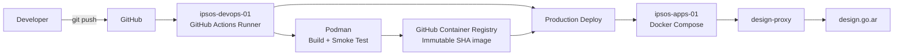

# IIS-Design Deployment Platform

Self-hosted CI/CD platform for IIS Design applications.

A developer only needs to push to GitHub. Builds, validation, container publishing and production deployment are handled automatically by the platform.

## Architecture



## Deployment flow

1. A developer pushes to GitHub.
2. The self-hosted runner builds the container with Podman.
3. The container is smoke-tested before publication.
4. The validated image is published to GHCR using the Git commit SHA.
5. Production pulls the immutable image and pins it by digest.
6. The application health check is validated automatically.
7. If the new release is unhealthy, production automatically rolls back to the previous image.

## Migrated applications

| Application | Production route | Status |
| --- | --- | --- |
| UXIpsos Pages | `/uxipsos-pages/` | ✅ |
| Core | `/core/` | ✅ |
| Mustang | `/mustang/` | ✅ |
| Prototypes | `/prototypes/` | ✅ |
| UI Library | `/ui-library/` | ✅ |
| Astra | `/astra/` | ✅ |

## Shared deployment workflow

Applications use the reusable workflow:

```text
.github/workflows/container-deploy.yml
```

This keeps build, smoke-test, container publishing and production deployment behavior consistent across repositories.

## Key properties

- Push-to-deploy developer workflow
- Self-hosted GitHub Actions runner
- Rootless Podman builds
- GitHub Container Registry
- Immutable SHA images
- Production pinned by image digest
- Per-application health checks
- Automatic rollback
- Shared reusable CI/CD workflow
- No VPN or production access required for developers

## Operations

Detailed architecture, application onboarding, health checks, rollback and runner recovery procedures are documented in:

**[Deployment Platform Runbook](docs/deployment-platform.md)**
